# Système de Gestion de Parking

## 🇫🇷 Français

### Présentation

Application web de gestion d'un parking développée avec le framework **Django** (architecture MVT). Elle centralise la gestion des **clients**, des **réservations**, de l'**état des places** et des **abonnements**, avec une **authentification** (inscription / connexion), un **tableau de bord** et un **back-office** complet (CRUD) pour chaque entité.

Le projet suit une démarche reproductible : modélisation des données, mise en place des vues et formulaires Django, authentification, migrations, peuplement d'un jeu de démonstration, validation automatisée et documentation par captures d'écran.

Le rapport détaillé est disponible dans [rapport_final.md](./rapport_final.md).

### Contexte et problématique

La gestion manuelle d'un parking (suivi des places, des réservations, des abonnés et des encaissements) repose souvent sur des tableurs dispersés ou des registres papier. Cette organisation entraîne des risques de **double saisie**, de **pertes d'information**, de **rupture de traçabilité** et une difficulté à produire des indicateurs fiables sur l'occupation et les revenus.

Le projet répond à la question suivante :

> Comment centraliser et fiabiliser la gestion quotidienne d'un parking (clients, réservations, places, abonnements) dans une application web unique, traçable et prête à alimenter de futurs traitements data / IA ?

### Données et modèle métier

L'application s'appuie sur le **ORM Django** et une base **SQLite**. Quatre modèles métier structurent les données :

| Modèle | Rôle | Champs principaux |
|---|---|---|
| `Clients` | Personne cliente du parking | `code`, `Nom`, `Prenom`, `email`, `username`, `Password`, `user` (FK) |
| `Reservations` | Réservation d'une place sur une période | `idReservation`, `dateDebut`, `dateFin`, `Prix`, `code` (FK Client) |
| `PlacesLibres` | État courant des places | `NombrePlaceDisponible`, `NombrePlaceReserver` |
| `Abonnements` | Formules d'abonnement | `TypeAbonnement`, `DureeAbonnement`, `Prix` |

L'authentification réelle s'appuie sur la table `auth_user` de Django. La table `Clients` conserve en plus des champs de démonstration (`username`, `Password`) pour illustrer le formulaire métier ; **ces champs ne constituent pas le mécanisme d'authentification**, qui repose sur `django.contrib.auth`.

Le jeu de démonstration (`seed_data.py`) crée : **1 superutilisateur**, **6 clients**, **5 réservations**, **1 état des places** et **4 abonnements**. Les données sont fictives et servent uniquement à la démonstration.

### Méthodologie

1. **Analyse des besoins** : identification des entités métier et des parcours utilisateur.
2. **Conception** : modélisation des données (modèles + relations) et organisation MVT de Django.
3. **Implémentation** : vues (`views.py`), formulaires (`forms.py`), routage (`urls.py`) et templates Bootstrap.
4. **Authentification** : inscription et connexion via `django.contrib.auth`.
5. **Migrations** : schéma de base versionné et reproductible.
6. **Peuplement** : jeu de démonstration idempotent (`get_or_create`).
7. **Validation** : vérification du projet (`check`), application des migrations, test HTTP de toutes les routes.
8. **Documentation** : captures d'écran automatisées des interfaces.

### Résultats de validation

Le projet a été testé localement. Résultats observés :

| Contrôle | Résultat |
|---|---|
| `python manage.py check` | Aucune anomalie (0 problème) |
| `python manage.py migrate` | Migrations appliquées avec succès |
| `python seed_data.py` | 1 admin, 6 clients, 5 réservations, 4 abonnements |
| Test HTTP des 13 routes | Toutes en **HTTP 200** |

Les routes validées : `Accueil`, `About`, `Login`, `Registration`, `Dashboard`, et les pages **Liste / Ajouter** de Clients, Réservations, Places et Abonnements.

> Environnement de test : Python 3.13, Django 5.1, SQLite. Le projet est également compatible avec la version Django 4.1.7 indiquée dans `requirements.txt`.

### Fonctionnalités (interfaces)

L'application propose les parcours suivants :

- **Accueil** : page publique de bienvenue et présentation du service.
- **À propos** : description du domaine et de la solution.
- **Inscription / Connexion** : création de compte et authentification.
- **Tableau de bord** : menu de navigation vers les modules.
- **Clients** : lister, ajouter, modifier, supprimer.
- **Réservations** : lister, ajouter, modifier, supprimer.
- **Places libres** : consulter l'état, ajouter, modifier.
- **Abonnements** : lister, ajouter, modifier.
- **Admin Django** : back-office intégré (`/admin`).


### Captures d'écran des interfaces

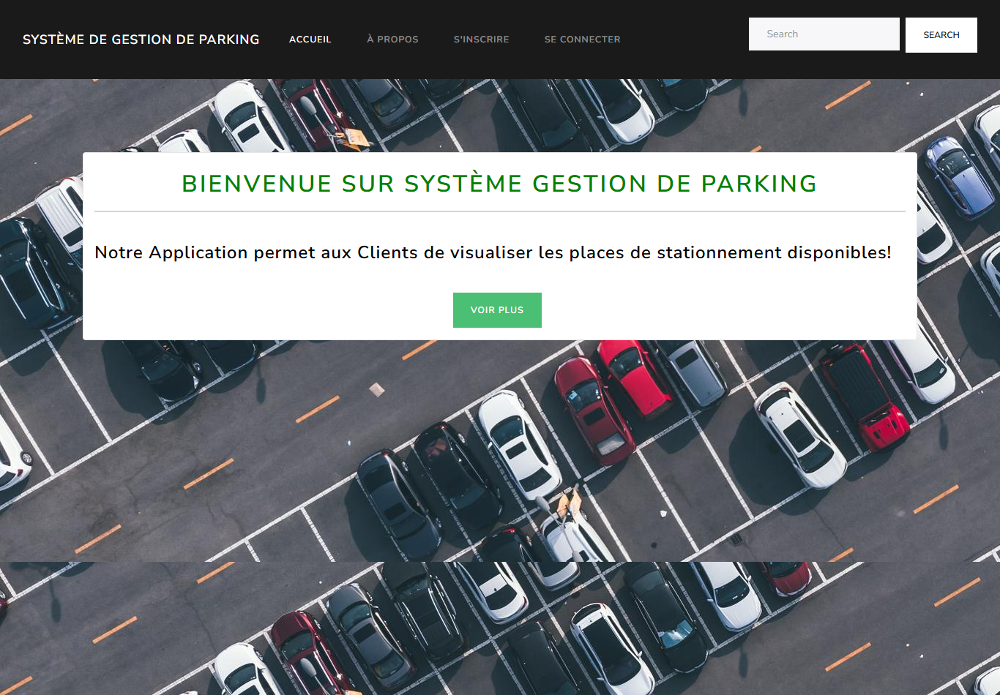

*Page d'accueil publique.*

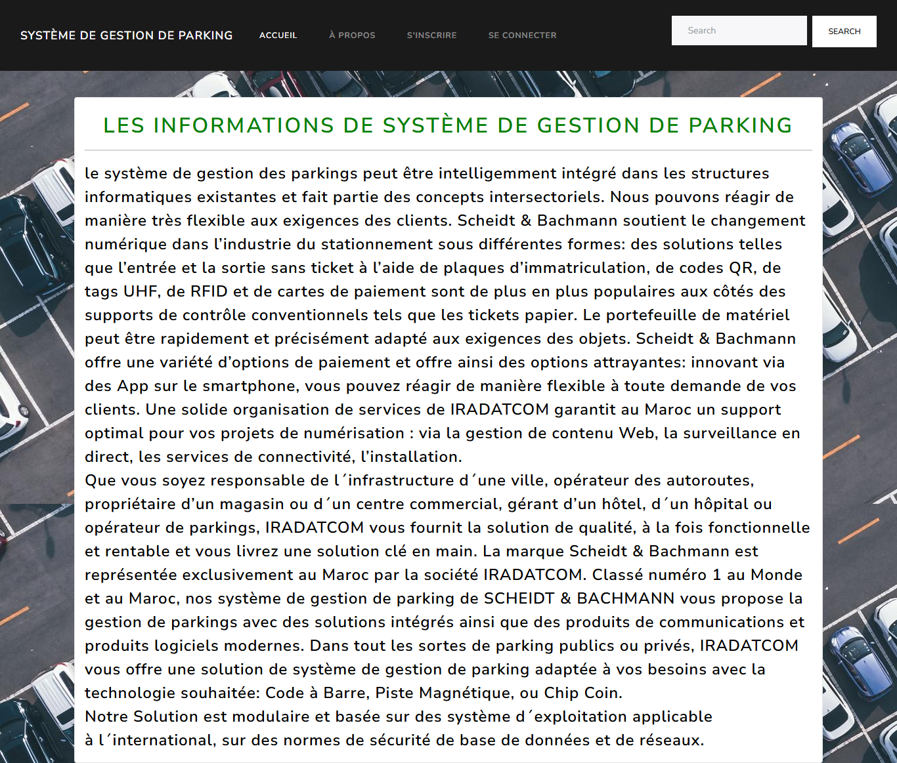

*Page « À propos » décrivant la solution.*

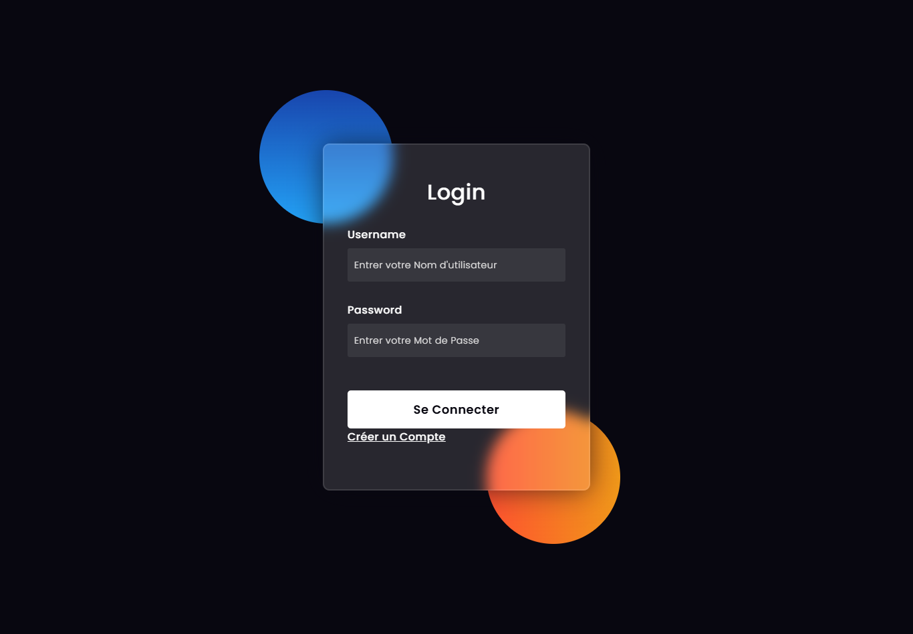

*Formulaire de connexion.*

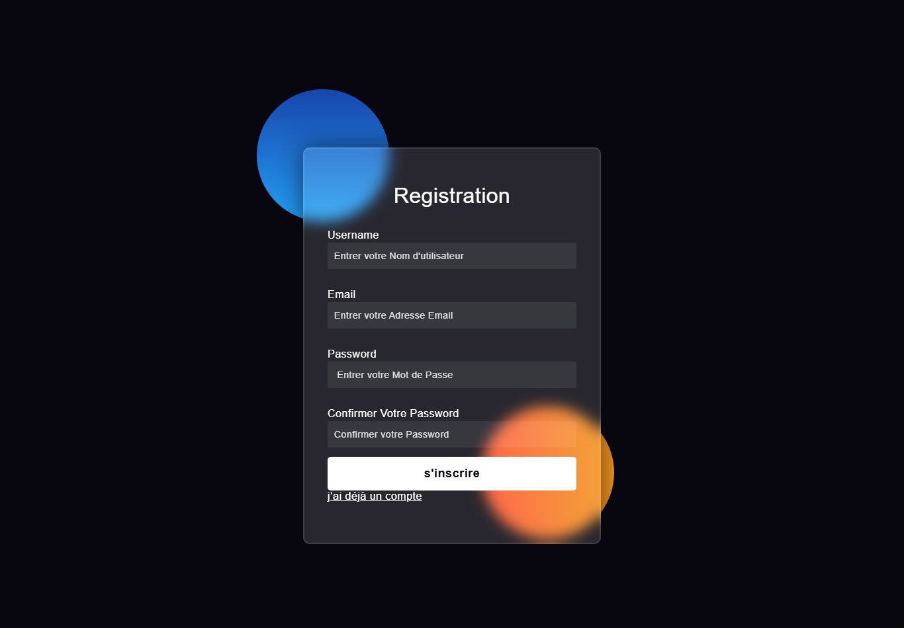

*Formulaire d'inscription.*

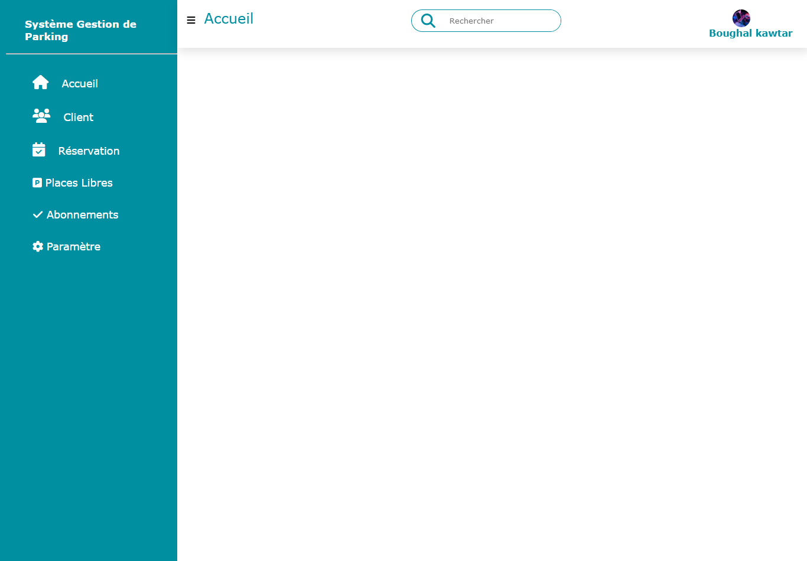

*Tableau de bord avec menu latéral.*

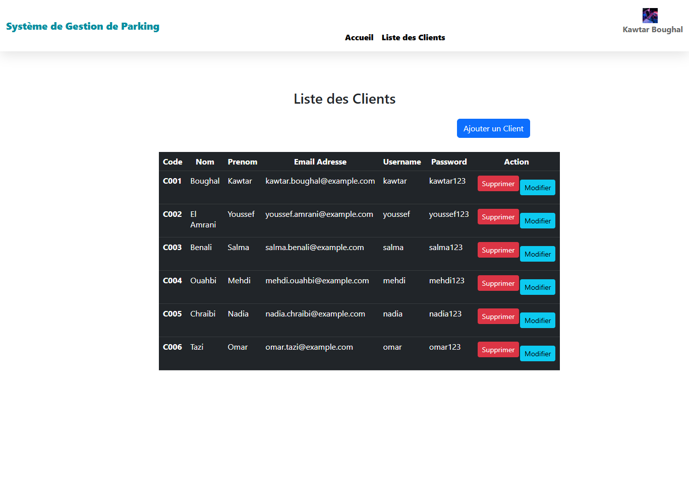

*Liste des clients avec actions Supprimer / Modifier.*

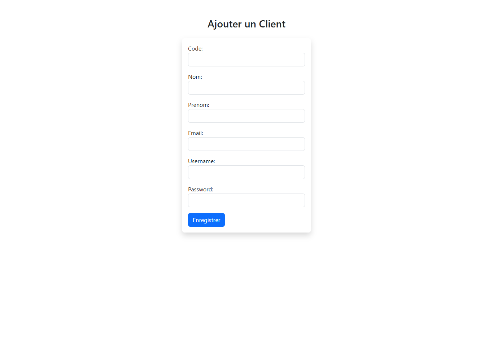

*Formulaire d'ajout d'un client.*

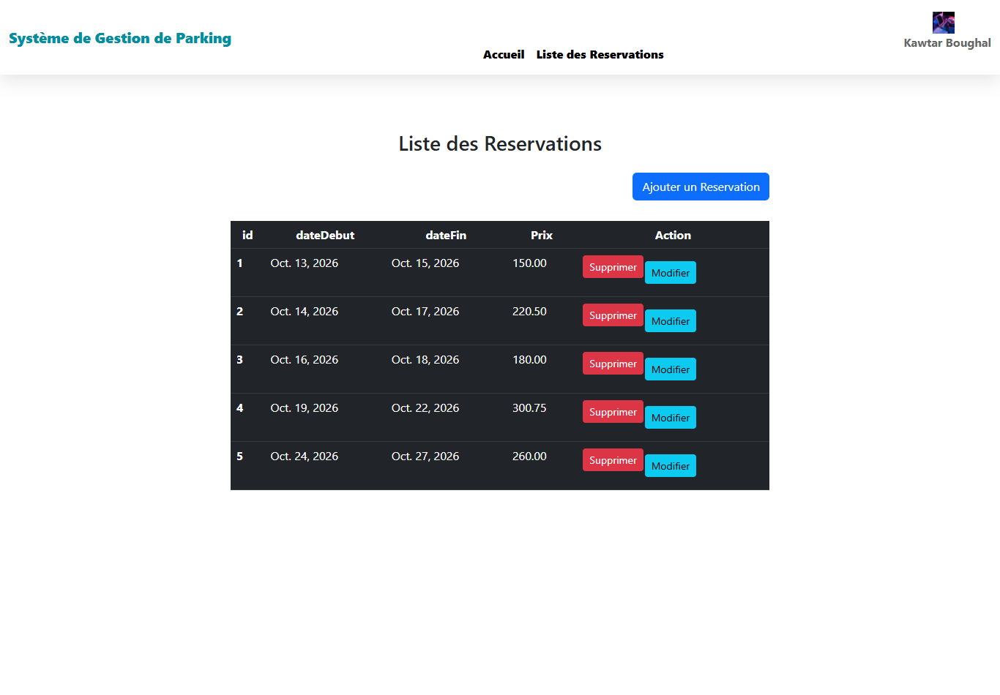

*Liste des réservations.*

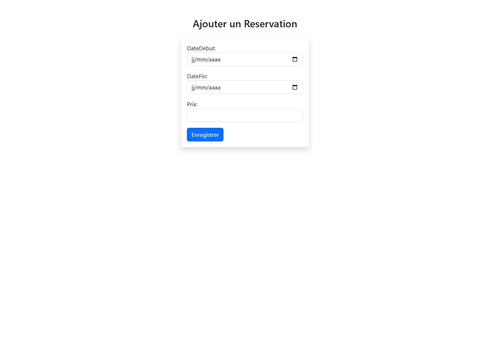

*Formulaire d'ajout d'une réservation.*

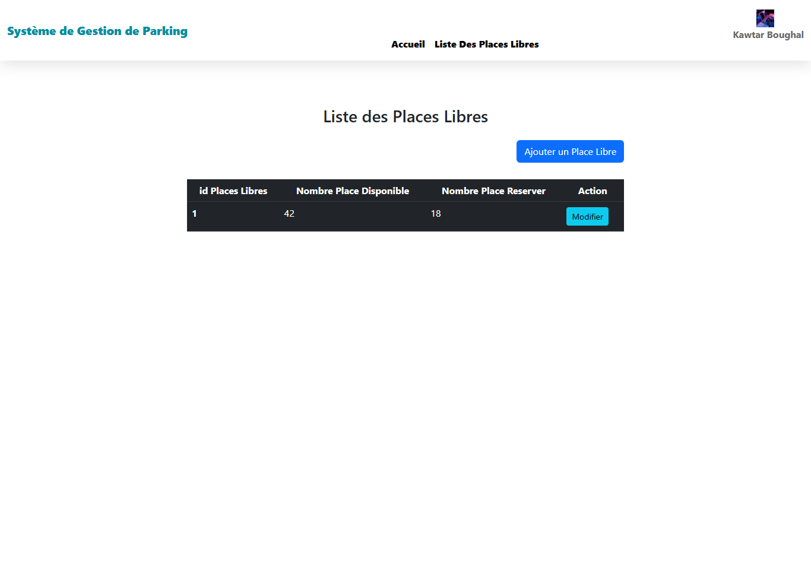

*État des places disponibles et réservées.*

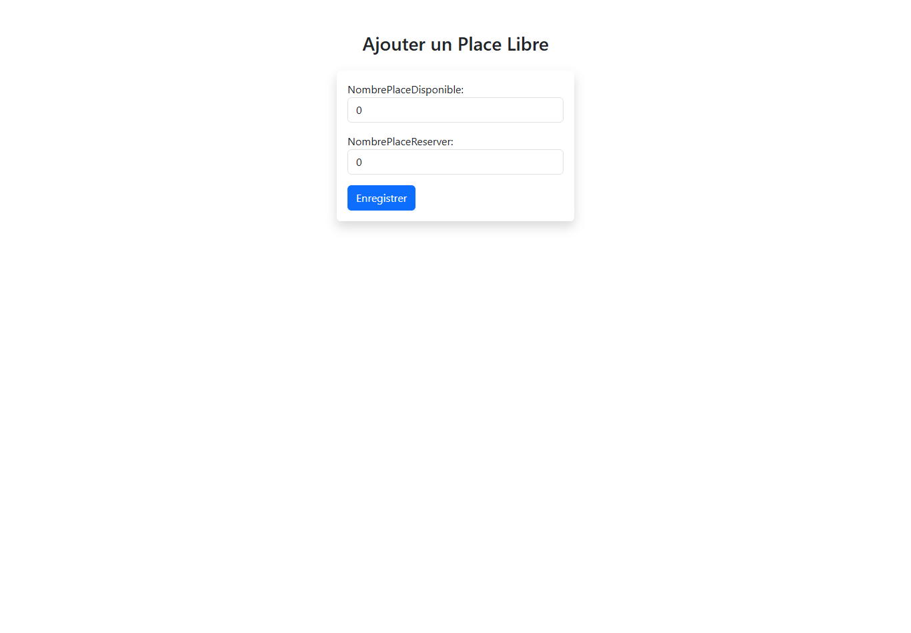

*Formulaire de mise à jour de l'état des places.*

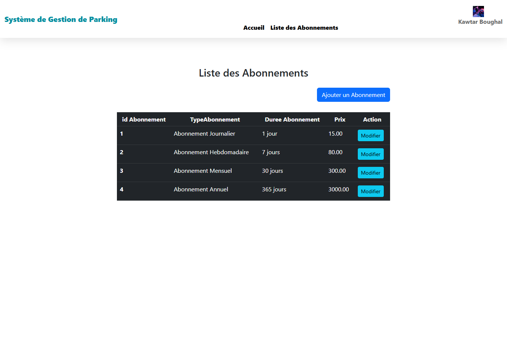

*Liste des formules d'abonnement.*

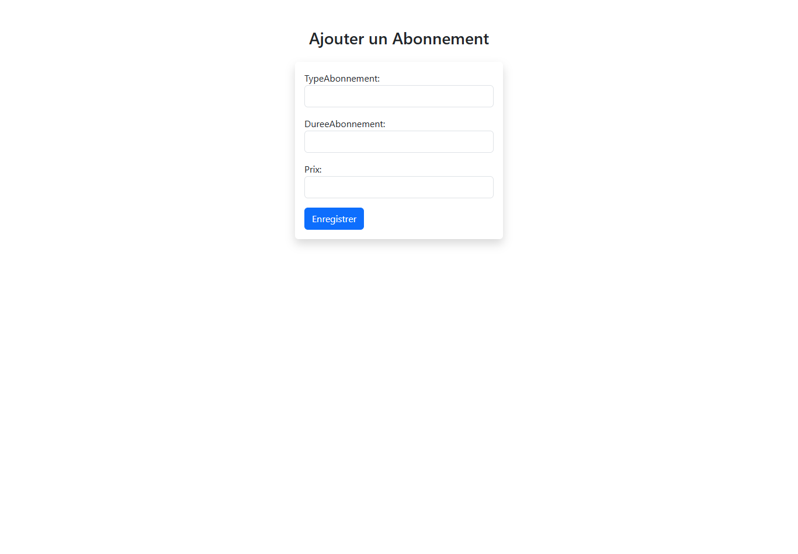

*Formulaire d'ajout d'un abonnement.*

### Structure du projet

```text
.
├── Gestion_Parking/                  # application Django (modèles, vues, formulaires)
│   ├── models.py
│   ├── views.py
│   ├── forms.py
│   ├── urls.py
│   ├── admin.py
│   ├── migrations/                   # schéma de base versionné
│   └── templates/                    # templates Bootstrap (16 fichiers)
│       ├── Accueil.html, About.html, Login.html,
│       ├── Registration.html, Dashboard.html, header.html
│       ├── clients/, Reservation/, PlacesLibres/, Abonnements/
├── Systeme_Gestion_Parking/          # configuration du projet
│   ├── settings.py
│   ├── urls.py
│   ├── wsgi.py
│   └── asgi.py
├── static/                           # CSS / images (Bootstrap, Font Awesome)
├── docs/
│   └── screenshots/                  # captures des interfaces (13 PNG)
├── seed_data.py                      # peuplement de démonstration (idempotent)
├── seed_demo.py                      # variante compacte de peuplement
├── capture_screenshots.py            # capture automatisée des interfaces
├── manage.py
├── requirements.txt
├── .gitignore
├── README.md
└── rapport_final.md
```

### Installation et lancement local

Prérequis : **Python 3.11 ou plus récent**.

```powershell
python -m venv venv
.\venv\Scripts\Activate.ps1
python -m pip install -r requirements.txt
python manage.py migrate
python seed_data.py
python manage.py runserver
```

Ouvrir ensuite :

| Page | Adresse |
|---|---|
| Accueil | http://127.0.0.1:8000/ |
| Connexion | http://127.0.0.1:8000/Login |
| Tableau de bord | http://127.0.0.1:8000/Dashboard |
| Admin Django | http://127.0.0.1:8000/admin |

Compte de démonstration (admin Django) : **admin** / **Admin@123**.

### Régénérer les captures d'écran

```powershell
python -m pip install playwright
python capture_screenshots.py
```

Le script démarre le serveur Django, photographie chaque interface avec Playwright (via le navigateur Chrome déjà installé sur le système), puis arrête le serveur. Les images sont enregistrées dans `docs/screenshots/`.


### Technologies et compétences

| Technologie | Utilisation dans le projet |
|---|---|
| Python | Langage principal |
| Django 4.1 / 5.1 | Framework web (MVT), ORM, authentification |
| SQLite | Base de données relationnelle |
| Django Forms + CSRF | Formulaires sécurisés et validation |
| Bootstrap 5, Font Awesome | Interface responsive et icônes |
| HTML / CSS | Templates et mise en page |
| Playwright | Capture automatisée des interfaces |
| Git / GitHub | Versionnement et publication |

### Objectif, solutions développées et impact

- **Objectif** : fiabiliser et centraliser la gestion quotidienne d'un parking.
- **Solutions développées** : CRUD complet des quatre entités, authentification, tableau de bord, back-office admin, jeu de démonstration et validation automatisée.
- **Impact attendu** : suppression de la double saisie, traçabilité des réservations et abonnements, vision claire de l'occupation, et constitution d'une **base de données propre**, prête à alimenter des analyses et des modèles d'IA.

### Lien Data Scientist / IA

L'application produit une base relationnelle structurée (occupation, durées de réservation, prix, formules d'abonnement, profils clients), qui constitue un **jeu de données naturel** pour des traitements analytiques. Extensions data / IA possibles :

- **Tableau de bord analytique** avec Pandas / Matplotlib (taux d'occupation, revenus par période).
- **Prévision de la demande** et de l'affluence (séries temporelles ou régression type XGBoost).
- **Détection d'anomalies** sur les réservations ou les paiements.
- **Tarification dynamique** selon l'occupation et la période.
- **OCR de plaques d'immatriculation** pour l'entrée / sortie automatique.
- **Chatbot de réservation** s'appuyant sur l'historique des clients.

Ces pistes transforment l'application d'un simple outil de gestion en une **plateforme data-ready**, directement alignée sur les compétences d'un Data Scientist.

### Limites et usage responsable

- Les mots de passe de démonstration sont stockés en clair dans la table métier `Clients` (usage pédagogique) ; l'authentification réelle utilise `auth_user` de Django.
- Pas de gestion fine des rôles (RBAC), pas de pagination ni de recherche côté serveur.
- SQLite en mono-poste, `DEBUG=True` et `SECRET_KEY` de développement dans les réglages.
- Les données sont fictives.
- Avant un usage en production : hacher les mots de passe, migrer vers PostgreSQL, activer HTTPS, durcir la configuration (`DEBUG=False`, clé secrète externalisée) et respecter le RGPD pour les données personnelles.

### Auteure

**Kawtar Boughal** — [LinkedIn](https://www.linkedin.com/in/kawtar-boughal02) · [GitHub](https://github.com/kawtarboughal02)


---

## 🇬🇧 English

### Overview

A car-park management web application built with the **Django** framework (MVT architecture). It centralizes the management of **clients**, **bookings**, **available spaces** and **subscriptions**, with **authentication** (sign-up / sign-in), a **dashboard** and a full **CRUD back-office** for each entity.

The project follows a reproducible workflow: data modeling, Django views and forms, authentication, migrations, demo data seeding, automated validation and screenshot documentation.

Read the detailed report in [rapport_final.md](./rapport_final.md).

### Context and problem

Manual car-park management (spaces, bookings, subscribers, payments) often relies on scattered spreadsheets or paper logs. This leads to **double entry**, **data loss**, **broken traceability** and makes it hard to produce reliable indicators on occupancy and revenue. The project centralizes and secures daily operations in a single, traceable, data-ready web application.

### Data model

The application uses the **Django ORM** with a **SQLite** database. Four business models structure the data: `Clients`, `Reservations`, `PlacesLibres` and `Abonnements`. Authentication relies on Django's built-in `auth_user` table. The demo seed creates 1 superuser, 6 clients, 5 bookings, 1 spaces state and 4 subscriptions (fictional data).

### Methodology and validation

Data modeling, MVT implementation (views, forms, URLs, Bootstrap templates), authentication, versioned migrations, idempotent seeding, and automated validation. Local test results: `manage.py check` reports no issues, `migrate` applies cleanly, and all 13 routes return HTTP 200. Tested with Python 3.13 and Django 5.1 (also compatible with Django 4.1.7 per `requirements.txt`).

### Application and setup

The application provides a public home page, an about page, sign-up / sign-in, a dashboard, and full CRUD for clients, bookings, spaces and subscriptions, plus the Django admin. Run it locally:

```powershell
python -m venv venv
.\venv\Scripts\Activate.ps1
python -m pip install -r requirements.txt
python manage.py migrate
python seed_data.py
python manage.py runserver
```

Then open http://127.0.0.1:8000/ (admin at `/admin`; demo superuser `admin` / `Admin@123`). Screenshots of every interface are in `docs/screenshots/` and can be regenerated with `python capture_screenshots.py` (requires Playwright).

### Technologies

Python, Django (MVT, ORM, auth), SQLite, Django Forms + CSRF, Bootstrap 5, Font Awesome, HTML/CSS, Playwright, Git/GitHub.

### Objective, solutions and impact

**Objective:** make daily car-park management reliable and centralized. **Solutions:** full CRUD for four entities, authentication, dashboard, Django admin, demo data and automated validation. **Impact:** no double entry, traceable bookings and subscriptions, clear occupancy view, and a clean relational dataset ready for data / AI analytics.

### Data Scientist / AI link

The relational data (occupancy, booking durations, prices, subscription plans, client profiles) is a natural dataset for analytics. Possible extensions: an analytical dashboard (Pandas/Matplotlib), demand forecasting (time-series or XGBoost regression), anomaly detection, dynamic pricing, license-plate OCR for entry/exit, and a booking chatbot.

### Limitations and responsible use

Demo passwords are stored in clear text in the `Clients` business table (educational use); real authentication uses Django's `auth_user`. No fine-grained RBAC, no server-side pagination or search. SQLite single-user, `DEBUG=True` and a development `SECRET_KEY`. Data is fictional. Before production: hash passwords, migrate to PostgreSQL, enable HTTPS, harden settings and comply with GDPR for personal data.

### Author

**Kawtar Boughal** — [LinkedIn](https://www.linkedin.com/in/kawtar-boughal02) · [GitHub](https://github.com/kawtarboughal02)

